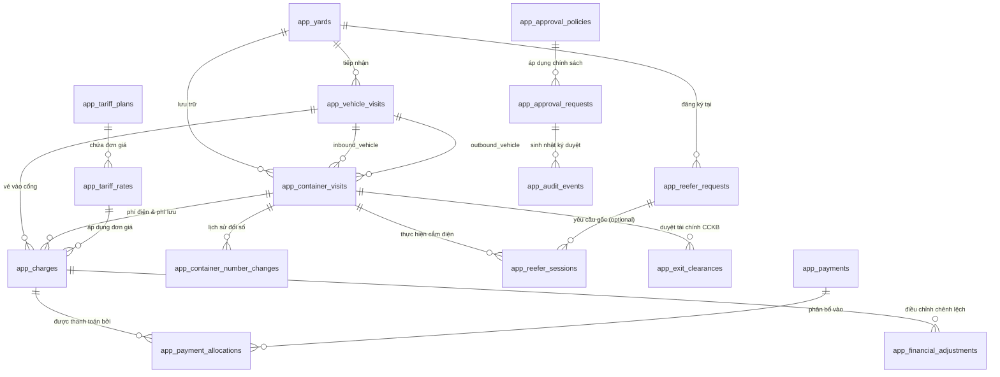

# THIẾT KẾ KIẾN TRÚC DỮ LIỆU NGHIỆP VỤ (DOMAIN SCHEMA DESIGN V5)
## DỰ ÁN: WEBSITE + PWA QUẢN LÝ BẾN BÃI/CẢNG CẠN SƠN CẢNG
**Công ty Cổ phần Tà Lùng Quang Minh**  
**Giai đoạn:** Phase 1C-A — Thiết kế Kiến trúc Dữ liệu Nghiệp vụ (Chưa triển khai migration)  
**Ngày lập:** 11/10/2026  
**Căn cứ chuẩn:** Workbook RBAC V5, `PROJECT_CONTEXT.md` V5, `DECISION_LOG.md`, `OPEN_DECISIONS_UAT.md`.

---

## I. NGUYÊN TẮC THIẾT KẾ BẤT BIẾN (INVARIANTS)

1. **Độc lập tuyệt đối giữa Lượt xe và Lượt container:**
   - Một lượt xe (`app_vehicle_visits`) quản lý hành trình di chuyển của phương tiện (vào cổng -> lưu bãi -> ra cổng).
   - Một lượt container (`app_container_visits`) quản lý vòng đời lưu trú của thùng container trong bãi (vào bãi -> hạ bãi/cắm điện/lưu bãi -> bốc xe/rút điện -> ra bãi).
   - Xe mang container vào bãi (Inbound Vehicle) có thể khác hoàn toàn với xe đến bốc container rời bãi (Outbound Vehicle). Số container không phải là khóa chính.
2. **Phiên cắm điện thực tế tách rời Yêu cầu điện dự kiến:**
   - Phiếu yêu cầu điện dự kiến (`app_reefer_requests`) do CCKB tiếp nhận trước không tự động tính tiền, không tạo phiên cắm đang chạy trước khi container vào bãi và cắm điện thật. Ghép nối giữa phiếu dự kiến và container thực tế bắt buộc xác nhận thủ công (Manual Match).
   - Phiên cắm điện thực tế (`app_reefer_sessions`) ghi nhận thời gian cắm/rút thực tế, làm tròn 15 phút do backend tính toán, áp dụng đơn giá theo bảng giá hiệu lực tại thời điểm cắm.
3. **Phí lưu bãi chỉ được tính và chốt khi container thực tế ra bãi:**
   - Phí lưu container (`LUU_CONTAINER`) tính theo khung đêm 22:00–06:00 (múi giờ Asia/Ho_Chi_Minh), miễn đêm đầu tiên.
   - **Tuyệt đối không khóa, không chốt và không tính trước phí lưu container khi CCKB duyệt tài chính hoặc khi khách rút điện trước 22:00.** Thời điểm chốt phí lưu là lúc An ninh ghi nhận container thực tế rời cổng ra.
4. **Xác nhận tài chính CCKB tách biệt Xác nhận xuất bãi của An ninh:**
   - Xác nhận của CCKB (`app_exit_clearances`) là sự kiểm soát về điều kiện tài chính (đã thu tiền điện hoặc ghi nhận ngoại lệ nợ).
   - Xác nhận xuất bãi của An ninh (`app_container_exit_events`) là thời điểm vật lý container ra khỏi cổng, tại đó backend tự động tính lại phí lưu bãi phát sinh.
5. **Sổ thu kế toán (Financial Ledger) bất biến:**
   - Khoản phải thu (`app_charges`), Tiền thực thu (`app_payments`), Phân bổ thu (`app_payment_allocations`).
   - Tiền đã thu không được sửa/xóa thành 0; mọi điều chỉnh sai lệch phải qua phiếu điều chỉnh (`app_financial_adjustments`) có phê duyệt và lưu giữ nhật ký kiểm toán.
6. **Mô hình Phê duyệt (Approval) gắn với Domain thật:**
   - Hồ sơ duyệt liên kết chặt chẽ với bản ghi nghiệp vụ thật qua `target_type` và `target_id`, lưu snapshot trước/sau, kiểm tra quyền và scope trên server, ghi audit trong cùng transaction.

---

## II. SƠ ĐỒ THỰC THỂ QUAN HỆ (ERD SƠ BỘ)



---

## III. CHI TIẾT CÁC BẢNG DỮ LIỆU NGHIỆP VỤ

### 1. Danh mục Loại Phương tiện Động (`app_vehicle_types`)

Bảng danh mục phương tiện quản lý động, khởi tạo bằng 7 loại xe chuẩn V5, kiểm soát khả năng chở container và giá vé cơ sở.

```sql
CREATE TABLE public.app_vehicle_types (
  code text PRIMARY KEY,
  display_name text NOT NULL,
  description text NULL,
  allows_container boolean NOT NULL DEFAULT false,
  default_ticket_amount numeric(12, 2) NOT NULL DEFAULT 0.00 CHECK (default_ticket_amount >= 0),
  is_active boolean NOT NULL DEFAULT true,
  sort_order integer NOT NULL DEFAULT 0,
  created_at timestamptz NOT NULL DEFAULT now(),
  updated_at timestamptz NOT NULL DEFAULT now()
);
```

### 2. Phân hệ Phương tiện & Cổng vào/ra (`app_vehicle_visits`)

Bảng ghi nhận từng lượt xe ra vào bãi Sơn Cảng. Loại xe liên kết Foreign Key với `app_vehicle_types` (`ON DELETE RESTRICT`).

```sql
CREATE TABLE public.app_vehicle_visits (
  id uuid PRIMARY KEY DEFAULT gen_random_uuid(),
  yard_id uuid NOT NULL REFERENCES public.app_yards(id),
  
  -- Biển số xe: Nullable với xe bo 3 bánh / xe chuyên dụng nội bộ; bắt buộc với xe đầu kéo/tải
  license_plate text NULL,
  
  -- Loại xe: Khóa ngoại tham chiếu danh mục loại phương tiện động (ON DELETE RESTRICT)
  vehicle_type text NOT NULL REFERENCES public.app_vehicle_types(code) ON DELETE RESTRICT,
  
  -- Thông tin tài xế / người liên hệ
  driver_name text NULL,
  driver_phone text NULL,
  
  -- Vòng đời lượt xe
  entry_at timestamptz NOT NULL DEFAULT now(),
  entry_by uuid NOT NULL REFERENCES auth.users(id),
  exit_at timestamptz NULL,
  exit_by uuid NULL REFERENCES auth.users(id),
  
  -- Trạng thái lượt xe: IN_YARD (Đang trong bãi), EXITED (Đã xuất bãi), CANCELLED (Hủy do nhập nhầm)
  status text NOT NULL DEFAULT 'IN_YARD' CHECK (status IN ('IN_YARD', 'EXITED', 'CANCELLED')),
  
  -- Thông tin vé vào cổng giấy
  ticket_code text NULL,
  ticket_amount numeric(12, 2) NOT NULL DEFAULT 0.00,
  ticket_payment_status text NOT NULL DEFAULT 'UNPAID' CHECK (ticket_payment_status IN ('UNPAID', 'PAID', 'EXEMPT', 'CANCELLED')),
  
  note text NULL,
  created_at timestamptz NOT NULL DEFAULT now(),
  updated_at timestamptz NOT NULL DEFAULT now(),

  -- Ràng buộc logic
  CONSTRAINT ck_vehicle_exit_after_entry CHECK (exit_at IS NULL OR exit_at >= entry_at)
);
```

### 2. Phân hệ Container độc lập (`app_container_visits`)

Bảng ghi nhận vòng đời lưu bãi của từng container. **Số container không phải là khóa chính**, đảm bảo khi An ninh sửa sai số thì toàn bộ lịch sử, phiên điện và phí không bị gián đoạn.

```sql
CREATE TABLE public.app_container_visits (
  id uuid PRIMARY KEY DEFAULT gen_random_uuid(),
  yard_id uuid NOT NULL REFERENCES public.app_yards(id),
  
  -- Số container hiện hành (11 ký tự chuẩn ISO hoặc mã ký hiệu bãi)
  container_no_current text NOT NULL,
  container_no_original text NOT NULL,
  
  -- Kích thước / loại cont (20ft, 40ft, 45ft, RF - Lạnh, GP - Khô)
  container_size text NULL CHECK (container_size IN ('20', '40', '45', 'OTHER')),
  container_type text NULL DEFAULT 'RF',
  
  -- LIÊN KẾT XE VÀO VÀ XE RA HOÀN TOÀN ĐỘC LẬP
  -- Xe đưa container vào bãi (có thể là đầu kéo A)
  inbound_vehicle_visit_id uuid NOT NULL REFERENCES public.app_vehicle_visits(id),
  inbound_at timestamptz NOT NULL DEFAULT now(),
  
  -- Xe bốc container ra khỏi bãi (có thể là đầu kéo B khác)
  outbound_vehicle_visit_id uuid NULL REFERENCES public.app_vehicle_visits(id),
  outbound_at timestamptz NULL,
  
  -- Trạng thái container trong bãi: IN_YARD, EXITED, CANCELLED
  status text NOT NULL DEFAULT 'IN_YARD' CHECK (status IN ('IN_YARD', 'EXITED', 'CANCELLED')),
  
  -- Trạng thái HÀNG / RỖNG do Bộ phận Điều phối phụ trách
  cargo_status text NULL DEFAULT 'CHUA_XAC_DINH' CHECK (cargo_status IN ('HANG', 'RONG', 'CHUA_XAC_DINH')),
  cargo_status_updated_at timestamptz NULL,
  cargo_status_updated_by uuid NULL REFERENCES auth.users(id),
  
  -- Cờ nhận diện dữ liệu chuyển đổi lịch sử từ AppSheet
  is_legacy_import boolean NOT NULL DEFAULT false,
  legacy_import_notes text NULL,
  
  created_at timestamptz NOT NULL DEFAULT now(),
  updated_at timestamptz NOT NULL DEFAULT now(),

  CONSTRAINT ck_container_outbound_after_inbound CHECK (outbound_at IS NULL OR outbound_at >= inbound_at)
);

-- LƯU Ý KIẾN TRÚC QUAN HỆ XE - CONTAINER (SC-1C-A-01):
-- Trong thực tế logistics cửa khẩu, một xe đầu kéo có thể cõng mooc chở 2 container 20 feet (2x20ft).
-- Thiết kế giữ khóa ngoại inbound_vehicle_visit_id và outbound_vehicle_visit_id trong app_container_visits (quan hệ 1 Xe - Nhiều Cont).
-- TUYỆT ĐỐI KHÔNG TẠO UNIQUE INDEX cứng giới hạn 1 xe chỉ có 1 cont trong CSDL khi chưa có phê duyệt chính thức từ Chủ dự án.
-- Nếu nghiệp vụ V1 chốt chỉ cho phép tối đa 1 cont/chiều, ràng buộc sẽ được kiểm soát ở Application Layer/RPC để dễ dàng mở rộng khi cần.

-- Lịch sử chỉnh sửa số container có kiểm toán (An ninh sửa số sai theo quyền container.number.correct)
CREATE TABLE public.app_container_number_changes (
  id bigint GENERATED ALWAYS AS IDENTITY PRIMARY KEY,
  container_visit_id uuid NOT NULL REFERENCES public.app_container_visits(id) ON DELETE RESTRICT,
  old_number text NOT NULL,
  new_number text NOT NULL,
  reason text NOT NULL,
  evidence_url text NULL,
  changed_by uuid NOT NULL REFERENCES auth.users(id),
  changed_at timestamptz NOT NULL DEFAULT now(),
  notified_cckb boolean NOT NULL DEFAULT false,
  -- Quy trình CCKB đối soát mã lệch (container.number.discrepancy.port_reconcile)
  acknowledged_by uuid NULL REFERENCES auth.users(id),
  acknowledged_at timestamptz NULL
);
```

### 3. Phân hệ Yêu cầu điện dự kiến & Phiên cắm điện thực tế

#### 3.1 Yêu cầu điện dự kiến (`app_reefer_requests`)
CCKB tiếp nhận trước khi xe tới, không tính tiền trước, ghép thủ công với lượt container thật.

```sql
CREATE TABLE public.app_reefer_requests (
  id uuid PRIMARY KEY DEFAULT gen_random_uuid(),
  yard_id uuid NOT NULL REFERENCES public.app_yards(id),
  customer_name text NOT NULL,
  planned_container_no text NOT NULL,
  
  -- Chế độ cắm dự kiến: DIEN_CONT_GIO (Theo giờ), DIEN_CONT_LIEN_TUC (Liên tục)
  pricing_mode text NOT NULL CHECK (pricing_mode IN ('DIEN_CONT_GIO', 'DIEN_CONT_LIEN_TUC')),
  set_temperature numeric(5, 2) NULL, -- Nhiệt độ yêu cầu cài đặt (°C)
  
  -- Trạng thái: PENDING (Chờ ghép), MATCHED (Đã ghép container vào), CANCELLED (Hủy)
  request_status text NOT NULL DEFAULT 'PENDING' CHECK (request_status IN ('PENDING', 'MATCHED', 'CANCELLED')),
  matched_container_visit_id uuid NULL REFERENCES public.app_container_visits(id),
  matched_at timestamptz NULL,
  matched_by uuid NULL REFERENCES auth.users(id),
  
  note text NULL,
  created_by uuid NOT NULL REFERENCES auth.users(id),
  created_at timestamptz NOT NULL DEFAULT now()
);
```

#### 3.2 Phiên cắm điện thực tế (`app_reefer_sessions`)
Ghi nhận giờ cắm/rút thực tế ngoài bãi, tính thời lượng làm tròn 15 phút, snapshot đơn giá.

```sql
CREATE TABLE public.app_reefer_sessions (
  id uuid PRIMARY KEY DEFAULT gen_random_uuid(),
  yard_id uuid NOT NULL REFERENCES public.app_yards(id),
  container_visit_id uuid NOT NULL REFERENCES public.app_container_visits(id) ON DELETE RESTRICT,
  request_id uuid NULL REFERENCES public.app_reefer_requests(id),
  
  -- Thời gian cắm/rút thực tế ngoài hiện trường
  -- ==============================================================================
  -- 1. SỰ KIỆN CẮM ĐIỆN VẬT LÝ (PLUG-IN) [SC-1C-A-02]
  -- ==============================================================================
  plug_in_at timestamptz NOT NULL,
  -- Nhân viên An ninh thao tác cắm thực tế ngoài hiện trường
  plug_in_field_operator_id uuid NULL REFERENCES auth.users(id),
  plug_in_field_operator_name text NULL,
  plug_in_notified_at timestamptz NULL,
  plug_in_notification_channel text NULL CHECK (plug_in_notification_channel IN ('ZALO', 'PHONE', 'RADIO', 'IN_PERSON')),
  -- Nhân viên CCKB tiếp nhận thông tin và ghi nhận lên PWA
  plug_in_recorded_by uuid NOT NULL REFERENCES auth.users(id),
  plug_in_recorded_at timestamptz NOT NULL DEFAULT now(),

  -- ==============================================================================
  -- 2. SỰ KIỆN RÚT ĐIỆN VẬT LÝ (PLUG-OUT) [SC-1C-A-02]
  -- (Có thể thực hiện bởi nhân viên An ninh khác ở ca trực khác; CCKB khác nhập liệu)
  -- ==============================================================================
  plug_out_at timestamptz NULL,
  -- Nhân viên An ninh thao tác rút thực tế ngoài hiện trường
  plug_out_field_operator_id uuid NULL REFERENCES auth.users(id),
  plug_out_field_operator_name text NULL,
  plug_out_notified_at timestamptz NULL,
  plug_out_notification_channel text NULL CHECK (plug_out_notification_channel IN ('ZALO', 'PHONE', 'RADIO', 'IN_PERSON')),
  -- Nhân viên CCKB tiếp nhận thông tin và ghi nhận lên PWA
  plug_out_recorded_by uuid NULL REFERENCES auth.users(id),
  plug_out_recorded_at timestamptz NULL,
  
  -- Ghi chú hiện trường cắm/rút chung (reefer.field_work.note)
  field_work_note text NULL,

  -- ==============================================================================
  -- 3. TRẠNG THÁI & TÍNH PHÍ ĐIỆN
  -- ==============================================================================
  -- Trạng thái: PLUGGED, UNPLUGGED, ZERO_DURATION_REVIEW, CANCELLED_NO_CONNECTION, CANCELLED
  status text NOT NULL DEFAULT 'PLUGGED' 
    CHECK (status IN ('PLUGGED', 'UNPLUGGED', 'ZERO_DURATION_REVIEW', 'CANCELLED_NO_CONNECTION', 'CANCELLED')),
  
  -- Tính toán thời lượng tự động bằng Backend
  actual_seconds integer NULL,     -- Số giây cắm thực tế (plug_out_at - plug_in_at)
  billed_minutes integer NULL,     -- Số phút tính tiền (làm tròn lên 15 phút theo V5)
  
  -- KIỂM SOÁT PHIÊN 0 GIÂY / BẤT THƯỜNG [SC-1C-A-03 / RV02]:
  -- Tuyệt đối không tự động miễn phí ngầm khi actual_seconds <= 0.
  -- Phiên đưa vào ZERO_DURATION_REVIEW; chỉ xác nhận 0đ khi chứng minh không có phiên điện thực tế.
  zero_duration_reason text NULL,
  zero_duration_verified_by uuid NULL REFERENCES auth.users(id),
  
  -- Điều chỉnh thời lượng sau phê duyệt (AP04: reefer.session.amendment.request -> approve) [V5 ĐÃ CHỐT]
  original_billed_minutes integer NULL,
  billed_minutes_override integer NULL,
  amendment_request_id uuid NULL REFERENCES public.app_approval_requests(id),
  
  -- Snapshot đơn giá áp dụng (Snapshot tại thời điểm cắm điện theo V5)
  tariff_rate_id uuid NULL,        -- FK tham chiếu bảng giá có phiên bản
  applied_hourly_rate numeric(12, 2) NOT NULL DEFAULT 100000.00,
  
  -- Liên kết khoản phải thu trong sổ thu
  charge_id uuid NULL,
  
  created_at timestamptz NOT NULL DEFAULT now(),
  updated_at timestamptz NOT NULL DEFAULT now(),

  CONSTRAINT ck_plug_out_after_in CHECK (plug_out_at IS NULL OR plug_out_at >= plug_in_at)
);

-- RÀNG BUỘC AN TOÀN: Một container không thể có 2 phiên đang cắm (PLUGGED) cùng lúc! [V5 ĐÃ CHỐT]
CREATE UNIQUE INDEX uq_container_active_plugged_session 
  ON public.app_reefer_sessions(container_visit_id) 
  WHERE status = 'PLUGGED';
```

### 4. Phân hệ Bảng giá có phiên bản & Sổ thu tài chính (Financial Ledger)

#### 4.1 Bảng giá có phiên bản (`app_tariff_plans` & `app_tariff_rates`)

```sql
CREATE TABLE public.app_tariff_plans (
  id uuid PRIMARY KEY DEFAULT gen_random_uuid(),
  plan_code text NOT NULL,
  version_number integer NOT NULL DEFAULT 1,
  name text NOT NULL,
  effective_from timestamptz NOT NULL,
  effective_to timestamptz NULL,
  -- Trạng thái: DRAFT (Đang dự thảo), ACTIVE (Hiệu lực), SUPERSEDED (Bị thay thế)
  status text NOT NULL DEFAULT 'DRAFT' CHECK (status IN ('DRAFT', 'ACTIVE', 'SUPERSEDED')),
  created_by uuid NOT NULL REFERENCES auth.users(id),
  published_by uuid NULL REFERENCES auth.users(id),
  created_at timestamptz NOT NULL DEFAULT now(),
  CONSTRAINT uq_plan_version UNIQUE (plan_code, version_number)
);

-- RÀNG BUỘC TOÀN VẸN BẢNG GIÁ: Tuyệt đối không cho phép 2 phiên bản cùng mã plan_code đều ACTIVE [V5 ĐÃ CHỐT]
CREATE UNIQUE INDEX uq_active_tariff_plan 
  ON public.app_tariff_plans(plan_code) 
  WHERE status = 'ACTIVE';

CREATE TABLE public.app_tariff_rates (
  id uuid PRIMARY KEY DEFAULT gen_random_uuid(),
  tariff_plan_id uuid NOT NULL REFERENCES public.app_tariff_plans(id) ON DELETE CASCADE,
  charge_code text NOT NULL, -- CONT_LANH, DAU_KEO, XE_BO_*, LUU_CONTAINER, DIEN_CONT_GIO, PHAT_MAT_VE...
  description text NOT NULL,
  unit_price numeric(12, 2) NOT NULL CHECK (unit_price >= 0),
  billing_unit text NOT NULL CHECK (billing_unit IN ('LUOT', 'GIO', 'DEM', 'LAN')),
  CONSTRAINT uq_plan_charge_code UNIQUE (tariff_plan_id, charge_code)
);
```

#### 4.2 Sổ thu hạch toán bất biến (`app_charges`, `app_payments`, `app_payment_allocations`)

```sql
-- 1. Khoản phải thu phát sinh theo nghiệp vụ
CREATE TABLE public.app_charges (
  id uuid PRIMARY KEY DEFAULT gen_random_uuid(),
  yard_id uuid NOT NULL REFERENCES public.app_yards(id),
  
  -- Phân loại phí
  charge_type text NOT NULL CHECK (charge_type IN ('VE_VAO', 'TIEN_DIEN', 'PHI_LUU', 'PHAT_MAT_VE')),
  
  -- Đối tượng chịu phí
  vehicle_visit_id uuid NULL REFERENCES public.app_vehicle_visits(id),
  container_visit_id uuid NULL REFERENCES public.app_container_visits(id),
  reefer_session_id uuid NULL REFERENCES public.app_reefer_sessions(id),
  
  -- Đơn giá snapshot và tính tiền
  charge_code text NOT NULL,
  unit_price numeric(12, 2) NOT NULL,
  quantity numeric(10, 2) NOT NULL DEFAULT 1.00,
  total_amount numeric(12, 2) NOT NULL CHECK (total_amount >= 0),
  
  -- Theo dõi thanh toán
  paid_amount numeric(12, 2) NOT NULL DEFAULT 0.00 CHECK (paid_amount <= total_amount),
  outstanding_amount numeric(12, 2) NOT NULL GENERATED ALWAYS AS (total_amount - paid_amount) STORED,
  
  -- Trạng thái khoản thu: UNPAID, PARTIAL, PAID, DEBT_EXCEPTION, CANCELLED
  status text NOT NULL DEFAULT 'UNPAID' CHECK (status IN ('UNPAID', 'PARTIAL', 'PAID', 'DEBT_EXCEPTION', 'CANCELLED')),
  
  -- Khóa chống double-click / network retry từ client (Idempotency Key) [SC-1C-A-06]
  idempotency_key text NULL UNIQUE,
  
  created_at timestamptz NOT NULL DEFAULT now(),
  updated_at timestamptz NOT NULL DEFAULT now()
);

-- RÀNG BUỘC NGHIỆP VỤ CHỐNG DOUBLE CHARGE (SC-1C-A-06):
-- 1. Mỗi phiên điện cụ thể chỉ sinh tối đa 1 khoản thu active (1-1 quan hệ chặt chẽ):
CREATE UNIQUE INDEX uq_charge_reefer_session 
  ON public.app_charges(reefer_session_id) 
  WHERE reefer_session_id IS NOT NULL AND status <> 'CANCELLED';

-- 2. Mỗi lượt xe chỉ sinh 1 khoản vé vào cổng active:
CREATE UNIQUE INDEX uq_charge_ticket_fee 
  ON public.app_charges(vehicle_visit_id, charge_type) 
  WHERE charge_type = 'VE_VAO' AND status <> 'CANCELLED';

-- 3. Phí lưu bãi container: Kiểm soát chống bấm trùng qua idempotency_key và RPC xuất bãi,
-- không khóa cứng UNIQUE(container_visit_id, charge_type) để cho phép các bút toán phát sinh 
-- hoặc điều chỉnh hợp lệ theo chu kỳ.


-- 2. Phiếu thu tiền thực nhận (Bất biến - Immutable Ledger)
CREATE TABLE public.app_payments (
  id uuid PRIMARY KEY DEFAULT gen_random_uuid(),
  yard_id uuid NOT NULL REFERENCES public.app_yards(id),
  receipt_number text NOT NULL,
  
  amount_received numeric(12, 2) NOT NULL CHECK (amount_received > 0),
  payment_method text NOT NULL CHECK (payment_method IN ('CASH', 'BANK_TRANSFER')),
  reference_code text NULL, -- Mã giao dịch ngân hàng nếu chuyển khoản
  
  payer_name text NULL,
  collected_by uuid NOT NULL REFERENCES auth.users(id),
  collected_at timestamptz NOT NULL DEFAULT now(),
  
  -- Nhu cầu xuất hóa đơn VAT (ghi nhận cho Kế toán GĐ sau)
  invoice_requested boolean NOT NULL DEFAULT false,
  invoice_buyer_info jsonb NULL,
  
  -- Khóa chống bấm đôi / retry (Idempotency Key) [SC-1C-A-06]
  idempotency_key text NULL UNIQUE,
  
  created_at timestamptz NOT NULL DEFAULT now()
);

-- 3. Phân bổ đồng tiền thanh toán cho từng khoản phí
CREATE TABLE public.app_payment_allocations (
  id uuid PRIMARY KEY DEFAULT gen_random_uuid(),
  payment_id uuid NOT NULL REFERENCES public.app_payments(id) ON DELETE RESTRICT,
  charge_id uuid NOT NULL REFERENCES public.app_charges(id) ON DELETE RESTRICT,
  allocated_amount numeric(12, 2) NOT NULL CHECK (allocated_amount > 0),
  allocated_at timestamptz NOT NULL DEFAULT now(),
  allocated_by uuid NOT NULL REFERENCES auth.users(id),
  CONSTRAINT uq_payment_charge UNIQUE (payment_id, charge_id)
);

-- 4. Điều chỉnh tài chính có kiểm soát (Sau khi đã thu tiền nhưng có sai sót/khiếu nại)
CREATE TABLE public.app_financial_adjustments (
  id uuid PRIMARY KEY DEFAULT gen_random_uuid(),
  charge_id uuid NOT NULL REFERENCES public.app_charges(id) ON DELETE RESTRICT,
  original_amount numeric(12, 2) NOT NULL,
  adjusted_amount numeric(12, 2) NOT NULL,
  difference_amount numeric(12, 2) NOT NULL,
  reason text NOT NULL,
  approval_request_id uuid NULL, -- FK tham chiếu app_approval_requests
  approved_by uuid NOT NULL REFERENCES auth.users(id),
  adjusted_at timestamptz NOT NULL DEFAULT now()
);
```

### 5. Phân hệ Phê duyệt Tài chính CCKB & Xuất bãi thực tế An ninh

#### 5.1 Xác nhận điều kiện tài chính CCKB (`app_exit_clearances`)
Cho phép xuất bãi về mặt thủ tục tài chính, **tuyệt đối không khóa phí lưu container**.

```sql
CREATE TABLE public.app_exit_clearances (
  id uuid PRIMARY KEY DEFAULT gen_random_uuid(),
  container_visit_id uuid NOT NULL REFERENCES public.app_container_visits(id) ON DELETE RESTRICT,
  
  -- Trạng thái: CLEARED (Đủ điều kiện xuất), DEBT_EXCEPTION (Ngoại lệ còn nợ), REVOKED (Đã thu hồi)
  status text NOT NULL CHECK (status IN ('CLEARED', 'DEBT_EXCEPTION', 'REVOKED')),
  
  -- Snapshot công nợ tại thời điểm CCKB kiểm tra
  outstanding_snapshot numeric(12, 2) NOT NULL DEFAULT 0.00,
  exception_reason text NULL, -- Bắt buộc nếu status = DEBT_EXCEPTION
  
  cleared_by uuid NOT NULL REFERENCES auth.users(id),
  cleared_at timestamptz NOT NULL DEFAULT now(),
  
  revoked_by uuid NULL REFERENCES auth.users(id),
  revoked_at timestamptz NULL,
  revocation_reason text NULL
);
```

#### 5.2 Sự kiện Xuất bãi thực tế An ninh (`app_container_exit_events`) [SC-1C-A-05]
Ghi nhận thời điểm vật lý container ra khỏi cổng, chốt phí lưu container thực tế theo chính sách **AP07**.

```sql
CREATE TABLE public.app_container_exit_events (
  id uuid PRIMARY KEY DEFAULT gen_random_uuid(),
  container_visit_id uuid NOT NULL REFERENCES public.app_container_visits(id) ON DELETE RESTRICT,
  outbound_vehicle_visit_id uuid NOT NULL REFERENCES public.app_vehicle_visits(id),
  clearance_id uuid NOT NULL REFERENCES public.app_exit_clearances(id),
  
  actual_exit_at timestamptz NOT NULL DEFAULT now(),
  confirmed_by uuid NOT NULL REFERENCES auth.users(id), -- Nhân viên An ninh cổng ra (exit.actual.confirm)
  
  -- Tính toán số đêm lưu bãi thực tế tại thời điểm ra (Backend tính theo khung 22h-6h)
  storage_night_count integer NOT NULL DEFAULT 0,
  storage_free_nights integer NOT NULL DEFAULT 1,
  storage_billable_nights integer NOT NULL DEFAULT 0,
  storage_fee_amount numeric(12, 2) NOT NULL DEFAULT 0.00,
  
  -- XỬ LÝ THANH TOÁN PHÁT SINH TẠI CỬA RA THEO CHÍNH SÁCH AP07:
  -- PAID: An ninh thu tiền mặt tại cổng ra (quyền storage.payment.collect)
  -- DEBT_EXCEPTION: Khách nợ, CCKB xác nhận ngoại lệ nợ bổ sung (quyền exit.clearance.debt_exception)
  -- EXEMPT: Miễn phí lưu theo chính sách
  -- NOT_APPLICABLE: Không phát sinh phí lưu (chưa qua đêm thứ 2)
  storage_payment_status text NOT NULL 
    CHECK (storage_payment_status IN ('PAID', 'DEBT_EXCEPTION', 'EXEMPT', 'NOT_APPLICABLE')),
  
  -- Nếu An ninh thu tiền mặt: Liên kết phiếu thu do An ninh lập
  storage_payment_id uuid NULL REFERENCES public.app_payments(id),
  
  -- Nếu cho ra còn nợ phí lưu mới: Nhân viên CCKB xác nhận ngoại lệ nợ theo AP07
  debt_exception_confirmed_by uuid NULL REFERENCES auth.users(id),
  debt_exception_reason text NULL,
  
  -- Khóa chống bấm đôi (Idempotency Key)
  idempotency_key text NULL UNIQUE,
  
  note text NULL,
  created_at timestamptz NOT NULL DEFAULT now(),

  -- RÀNG BUỘC LOGIC AP07: Nếu nợ mới thì bắt buộc phải có CCKB xác nhận ngoại lệ và lý do
  CONSTRAINT ck_ap07_debt_exception_fields CHECK (
    storage_payment_status <> 'DEBT_EXCEPTION' OR 
    (debt_exception_confirmed_by IS NOT NULL AND debt_exception_reason IS NOT NULL)
  )
);
```

---

### 6. Thuật toán Tính Phí Lưu Container Khung Đêm (Múi giờ Asia/Ho_Chi_Minh) [V5 ĐÃ CHỐT]

Quy tắc V5:
- Múi giờ chuẩn: `Asia/Ho_Chi_Minh` (UTC+7).
- Khung đêm xét phí lưu: **22:00 hôm trước đến 06:00 sáng hôm sau**.
- Đơn giá: **100.000 VNĐ / container / đêm**.
- Chính sách miễn phí: **Miễn đêm đầu tiên** (`storage_free_nights = 1`).
- **Thời điểm chốt tính tiền:** DUY NHẤT tại thời điểm An ninh ghi nhận container thực tế rời cổng ra (`actual_exit_at`). Tuyệt đối không chốt trước khi CCKB duyệt.

Thuật toán đếm số đêm:
Cho khoảng thời gian container lưu bãi từ $T_{in}$ (giờ vào) đến $T_{out}$ (giờ ra thực tế):
1. Duyệt qua từng ngày lịch $D$ trong khoảng từ $\text{date}(T_{in})$ đến $\text{date}(T_{out})$ (theo giờ địa phương Hà Nội).
2. Mỗi đêm $k$ ứng với ngày $D$ bắt đầu lúc $N_{start} = D\text{ 22:00:00+07}$ và kết thúc lúc $N_{end} = (D + 1\text{ ngày})\text{ 06:00:00+07}$.
3. Container được coi là "trải qua đêm $k$" nếu:
   $$\max(T_{in}, N_{start}) < \min(T_{out}, N_{end})$$
   (Nghĩa là khoảng lưu trú $[T_{in}, T_{out}]$ có giao nhau với khung đêm $[N_{start}, N_{end}]$ ít nhất 1 giây).
4. Tổng số đêm lưu thực tế = $\sum_{k} 1$.
5. Số đêm tính tiền = $\max(0, \text{Tổng số đêm} - 1)$ (do miễn đêm đầu tiên).
6. Phí lưu = $\text{Số đêm tính tiền} \times 100.000\text{ VNĐ}$.

---

## IV. MA TRẬN RÀNG BUỘC & ĐỦ 12 TRƯỜNG HỢP BIÊN BẮT BUỘC (EDGE CASES EC-01 ĐẾN EC-12)

| Mã | Tình huống nghiệp vụ | Ràng buộc Database & Cơ chế Xử lý | Trạng thái Nguồn |
| :--- | :--- | :--- | :--- |
| **EC-01** | Xe A mang cont C vào; xe A ra không cont; xe B đến nhận C sau nhiều ngày | `app_container_visits` lưu `inbound_vehicle_visit_id = Xe A`. Khi Xe A ra, chỉ cập nhật `app_vehicle_visits` của Xe A sang `EXITED`. Cont C vẫn giữ nguyên `status = 'IN_YARD'`. Nhiều ngày sau Xe B vào nhận C, cập nhật `outbound_vehicle_visit_id = Xe B`. Phí lưu bãi tính từ lúc cont vào đến khi Xe B kéo C ra cổng thực tế. | [V5 ĐÃ CHỐT] |
| **EC-02** | Xe đầu kéo không tải vào nhận container đang lưu | Xe đầu kéo vào cổng nhận vé vào loại `DAU_KEO` đơn giá 0đ (`ticket_amount = 0`). Khi ra kéo cont C, hệ thống chỉ tính phí lưu và các phiên điện của cont C; tuyệt đối không cộng thêm 250.000đ vé vào của xe container. | [V5 ĐÃ CHỐT] |
| **EC-03** | Cắm điện 14 phút 59 giây vs 15 phút 01 giây | Backend tính: `billed_minutes = ceil(actual_seconds / 900.0) * 15`. 14 phút 59 giây (899s) làm tròn lên 15 phút (100.000đ/4 = 25.000đ); 15 phút 01 giây (901s) làm tròn lên 30 phút (50.000đ). | [V5 ĐÃ CHỐT] |
| **EC-04** | Phiên cắm 0 giây hoặc sai giờ ngoài hiện trường | Phiên 0 giây (`actual_seconds <= 0`) tự động bật cờ `is_zero_duration = TRUE`, `billed_minutes = 0`, không sinh `charge_id`. Nếu do lỗi thiết bị/hiện trường, chuyển `CANCELLED` có lý do (tuân thủ RV02). | [UAT CÒN MỞ RV02] |
| **EC-05** | CCKB đã clearance lúc 16:00, nhưng cont nằm lại bãi qua đêm tới 08:00 sáng hôm sau mới ra | `app_exit_clearances` lúc 16:00 chỉ xác nhận điều kiện tài chính tiền điện. Khi An ninh ghi nhận xuất bãi lúc 08:00 sáng hôm sau, backend tính lại: cont đã trải qua thêm 1 đêm 22:00–06:00, phát sinh phí lưu bãi mới. An ninh thu tiền mặt hoặc CCKB duyệt ngoại lệ công nợ phát sinh mới trước khi xe qua cổng (tuân thủ RV06). | [UAT CÒN MỞ RV06] |
| **EC-06** | Hai nhân viên cùng bấm xác nhận cắm/rút hoặc xuất bãi đồng thời (Double Click / Concurrency) | RPC backend sử dụng khóa dòng `SELECT ... FOR UPDATE` trên bản ghi mục tiêu và kiểm tra điều kiện trạng thái tiên quyết (`status = 'IN_YARD'`, `status = 'PLUGGED'`). Giao dịch thứ nhất thành công; giao dịch thứ hai thấy trạng thái đã đổi -> trả về lỗi nghiệp vụ fail-safe, chống double charge/payment. | [KỸ THUẬT ĐẠT CHUẨN] |
| **EC-07** | Hai phiên điện chồng lấn trên cùng một lượt container | Cơ sở dữ liệu bảo vệ bằng Partial Unique Index `uq_container_active_plugged_session` trên `app_reefer_sessions(container_visit_id) WHERE status = 'PLUGGED'`. Bất kỳ RPC nào cố tạo phiên cắm thứ hai khi phiên cũ chưa `UNPLUGGED` đều bị Database chặn đứng ngay lập tức. | [V5 ĐÃ CHỐT] |
| **EC-08** | Sửa số container sau khi đã cắm điện và phát sinh thu phí | Khóa chính của lượt cont là `id` (UUID bất biến). Khi An ninh sửa số cont, cập nhật `container_no_current`, ghi lịch sử kiểm toán vào `app_container_number_changes`, giữ nguyên toàn bộ FK, phiên điện và khoản thu trong sổ thu. Gửi thông báo cho CCKB đối soát. | [V5 ĐÃ CHỐT] |
| **EC-09** | Sửa giờ cắm/rút sau khi đã thu tiền điện | Thực hiện qua quy trình phê duyệt **AP04**: nhân viên tạo `reefer.session.amendment.request`, TBP CCKB duyệt `reefer.session.amendment.approve`. Khi duyệt, giữ nguyên bản ghi thanh toán gốc, ghi nhận chênh lệch vào `app_financial_adjustments` và điều chỉnh `outstanding_amount`. | [V5 ĐÃ CHỐT] |
| **EC-10** | An ninh thử thu tiền điện / CCKB thử xác nhận xuất bãi xe tại cổng | Database RLS và RPC kiểm tra mã quyền chi tiết: An ninh không có quyền `reefer.payment.collect` -> DENY. CCKB không có quyền `exit.actual.confirm` -> DENY. Kiểm tra tại server, không phụ thuộc client. | [RBAC V5 ĐÃ CHỐT] |
| **EC-11** | Người đề nghị tự phê duyệt; Duyệt sai bãi hoặc sai bộ phận | Ràng buộc Four-Eyes `chk_four_eyes_actor (approved_by <> requested_by)` trên `app_approval_requests` chặn tự duyệt. Hàm `sc_approve_request()` kiểm tra scope: TBP bộ phận nào chỉ được duyệt yêu cầu của bộ phận đó (`sc_can(..., target_yard_id, target_dept)`). | [V5 ĐÃ CHỐT] |
| **EC-12** | Thay đổi bảng giá giữa hai phiên cắm điện của cùng container | Bảng giá có phiên bản (`app_tariff_plans`). Phiên cắm điện thứ nhất lưu snapshot `applied_hourly_rate` theo bảng giá lúc cắm. Khi bảng giá mới được ban hành qua AP10, phiên cắm thứ hai áp dụng đơn giá mới. Lịch sử phiên thứ nhất giữ nguyên không bị tính lại. | [V5 ĐÃ CHỐT] |


---

## V. ĐỀ XUẤT THỨ TỰ MIGRATIONS 004 TRỞ ĐI & KẾ HOẠCH KIỂM THỬ

### 1. Kế hoạch Migrations tuần tự (Độc lập phân tầng - SC-1C-A-07)
- **Migration 004 (`20261011000004_domain_vehicles_containers.sql`) [ĐỘC LẬP HOÀN TOÀN]:**
  - **Phạm vi đối tượng:** Chỉ tạo 3 bảng nền tảng: `app_vehicle_visits`, `app_container_visits`, `app_container_number_changes`.
  - **Ranh giới an toàn (SC-1C-A-07):** Tuyệt đối KHÔNG có bất kỳ khóa ngoại (FK) nào tham chiếu tới các bảng của Phase sau (`app_reefer_sessions`, `app_charges`, `app_exit_clearances`).
  - **Ràng buộc:** Giữ quan hệ 1 Xe - Nhiều Cont (hỗ trợ xe chở 2x20ft), không đặt Unique index cứng khi chưa duyệt; kiểm tra giờ ra sau giờ vào.
  - **RLS & Phân quyền:** Cấp quyền cho An ninh (tạo/sửa xe, cont, sửa số cont), CCKB (đọc, nhận thông báo lệch số), Điều phối (cập nhật HÀNG/RỖNG).
- **Migration 005 (`20261011000005_domain_reefer_operations.sql`):**
  - Bảng `app_reefer_requests`, `app_reefer_sessions` (tách bạch sự kiện cắm/rút hiện trường SC-1C-A-02).
  - Unique partial index chống cắm trùng container, RPC cắm/rút điện, hàm tính thời lượng làm tròn 15 phút, xử lý `ZERO_DURATION_REVIEW` (SC-1C-A-03).
- **Migration 006 (`20261011000006_domain_tariff_billing_ledger.sql`):**
  - Bảng `app_tariff_plans`, `app_tariff_rates`, `app_charges`, `app_payments`, `app_payment_allocations`, `app_financial_adjustments`.
  - Hàm tính phí lưu bãi theo mốc đêm 22h–6h, RPC ghi nhận thu tiền nguyên tử có `idempotency_key` và phân bổ thanh toán.
- **Migration 007 (`20261011000007_domain_exit_clearance_atomic_checkout.sql`):**
  - Bảng `app_exit_clearances`, `app_container_exit_events`.
  - RPC xác nhận tài chính CCKB, RPC An ninh xác nhận xuất bãi nguyên tử tuân thủ chính sách **AP07** (An ninh thu phí lưu tại cổng, CCKB xác nhận ngoại lệ nợ).
  - Tích hợp liên kết `app_approval_requests` với Domain Schema (thay thế trạng thái fail-closed của SC-R3-05).

### 2. Kế hoạch Kiểm thử pgTAP cho từng Migration
- **Test Suite 004 (Xe & Container):** Kiểm thử xe vào/ra độc lập; xe vào khác xe ra; xe chở 1 hoặc 2 cont 20ft; sửa số container giữ nguyên UUID; Điều phối cập nhật HÀNG/RỖNG.
- **Test Suite 005 (Điện Lạnh):** Kiểm thử tạo yêu cầu dự kiến; ghép thủ công; cắm/rút điện có 2 nhân viên hiện trường khác nhau; chặn cắm 2 phiên cùng lúc; làm tròn 15 phút tại ranh giới 899s vs 901s; kiểm soát phiên 0s.
- **Test Suite 006 (Bảng giá & Sổ thu):** Kiểm thử đơn giá phiên bản; tính phí lưu bãi qua đêm; thanh toán từng phần; phân bổ thanh toán; bất biến tiền đã thu; điều chỉnh có phê duyệt.
- **Test Suite 007 (Xuất bãi & AP07):** Kiểm thử CCKB duyệt không khóa tiền lưu; An ninh chốt xuất bãi tính lại phí lưu; An ninh thu phí lưu phát sinh tại cổng; CCKB duyệt ngoại lệ nợ AP07; snapshot trước/sau và audit trong cùng transaction.

---

## VI. DANH SÁCH CÁC CÂU HỎI NGHIỆP VỤ CẦN CHỦ DỰ ÁN XÁC NHẬN (DECISION CHECKLIST)

1. **Câu hỏi trọng yếu 1 (SC-1C-A-01): Xe chở 2 container 20 feet (2x20ft):**
   - *Câu hỏi:* Bến bãi Sơn Cảng có tiếp nhận xe đầu kéo chở 2 container 20 feet trong cùng một lượt xe vào/ra không?
   - *Phương án A (Khuyến nghị):* Cho phép 1 lượt xe liên kết tối đa 2 container 20ft (quan hệ 1 Xe - Nhiều Cont trong CSDL); kiểm tra loại cont 20ft ở application layer.
   - *Phương án B:* Khóa cứng 1 lượt xe chỉ được cõng đúng 1 container (nếu thực tế bãi không bao giờ cho chở 2 cont/xe).
2. **Câu hỏi 2 (SC-1C-A-03 / RV02): Kiểm soát phiên điện 0 giây:**
   - *Câu hỏi:* Xử lý phiên điện có thời lượng $\le 0$ giây do lỗi cắm rút tức thời thế nào?
   - *Phương án A (Khuyến nghị):* Đưa vào trạng thái `ZERO_DURATION_REVIEW`; yêu cầu nhập lý do và có xác nhận của TBP CCKB chứng minh không có kết nối điện thực tế thì mới được set 0đ; không miễn phí tự động ngầm.
   - *Phương án B:* Tự động hủy và không tính phí ngay khi phát hiện `actual_seconds <= 0`.
3. **Câu hỏi 3 (SC-1C-A-05 / RV06): Thu phí lưu bãi phát sinh tại cổng ra theo AP07:**
   - *Câu hỏi:* Khi có phí lưu bãi phát sinh sau khi CCKB đã clearance, quy trình thu và xử lý nợ thế nào?
   - *Phương án A (Khuyến nghị - Đúng V5):* An ninh thu tiền mặt tại cổng bằng quyền `storage.payment.collect`. Nếu khách nợ, CCKB xác nhận ngoại lệ nợ bổ sung qua quyền `exit.clearance.debt_exception` (AP07) trên PWA; không hủy clearance cũ.
   - *Phương án B:* Hủy clearance cũ, bắt xe quay lại phòng CCKB xử lý lại.
4. **Câu hỏi 4 (SC-1C-A-04 / RV04): Bảng giá lưu bãi thay đổi giữa kỳ:**
   - *Câu hỏi:* Khi bảng giá lưu bãi thay đổi lúc container đang ở trong bãi, phí lưu tính thế nào?
   - *Phương án A (Khuyến nghị):* Mỗi đêm lưu áp dụng đơn giá theo bảng giá có hiệu lực tại mốc 22:00 của đêm đó.
   - *Phương án B:* Áp dụng đơn giá tại thời điểm container vào cổng cho toàn bộ các đêm lưu.
5. **Câu hỏi 5 (AP12 / RV09): Nhận diện người trực bốt An ninh dùng chung thiết bị:**
   - *Phương án A (Khuyến nghị):* Mỗi nhân viên đăng nhập tài khoản cá nhân riêng trên PWA, chuyển ca bắt buộc đăng xuất/đăng nhập lại để gắn trách nhiệm cá nhân cho từng khoản thu.
   - *Phương án B:* Cho phép dùng tài khoản chung của bốt, nhưng nhập mã PIN cá nhân cho mỗi thao tác nhạy cảm.

