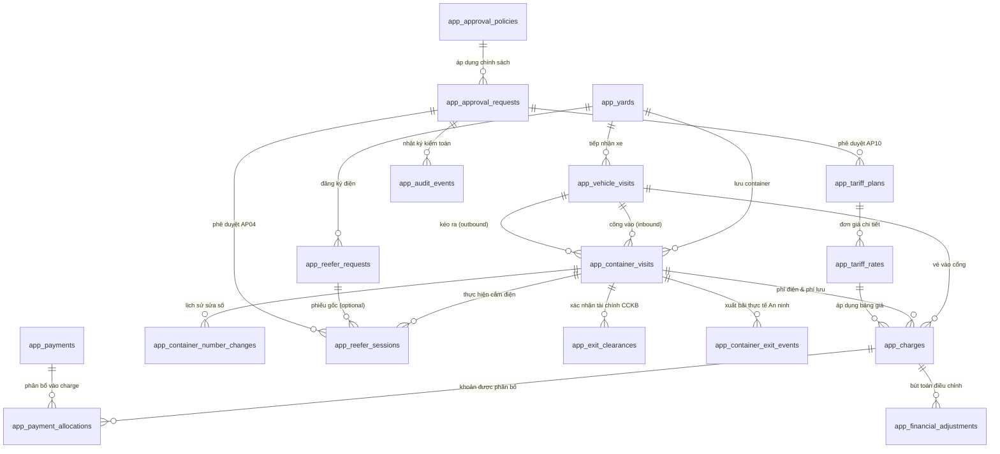

# BÁO CÁO RÀ SOÁT THIẾT KẾ DOMAIN SCHEMA V5 (PHASE 1C-A DESIGN REVIEW REPORT)

**Dự án:** Phần mềm quản lý bến bãi/cảng cạn Sơn Cảng — Công ty Cổ phần Tà Lùng Quang Minh  
**Thời điểm thực hiện:** 11/10/2026 19:15  
**Giai đoạn:** Phase 1C-A — Design Review Only (Chỉ rà soát thiết kế, không can thiệp CSDL)  
**Môi trường Backend:** Supabase Cloud DEV (`son-cang-yms-dev`, ref: `euswzyespwaxyrjkfkrq`)  
**Tài liệu đối chiếu:** `PROJECT_CONTEXT.md` V5, Workbook RBAC V5 (tab 19–28), `OPEN_DECISIONS_UAT.md`, `DECISION_LOG.md`, `SonCang_Phase1C_A_Review_Checklist_V5_20261011.md`.

---

## I. TỔNG QUAN KẾT QUẢ RÀ SOÁT (EXECUTIVE SUMMARY)

| Phân loại | Số lượng | Đánh giá cốt lõi |
|---|:---:|---|
| **ĐẠT (Passed Invariants)** | **8 nhóm** | Giữ vững 6 bất biến cốt lõi: Xe ≠ Container độc lập; Phí lưu chỉ chốt tại cổng ra lúc cont ra thực tế; Điện làm tròn 15 phút per session; Bảng giá phiên bản có snapshot; Ledger sổ thu bất biến; Phân định Clearance CCKB vs Xuất bãi An ninh; RBAC 8 roles / 67 perms / 206 grants. |
| **KHẮC PHỤC THEO KIỂM TOÁN ĐỘC LẬP** | **7 phát hiện** | Xử lý triệt để 7 phát hiện SC-1C-A-01 đến SC-1C-A-07: Bỏ Unique Index cứng 1 xe 1 cont (hỗ trợ 2x20ft); Tách 2 sự kiện cắm/rút hiện trường; Không auto miễn tiền phiên 0s (RV02); Tách chính sách giá điện và giá lưu bãi (RV03/RV04); Chuẩn hóa thanh toán tại cổng ra theo AP07; Thêm Idempotency key chống double charge; Cô lập ranh giới Migration 004. |
| **CẦN QUYẾT ĐỊNH (Open Decisions)** | **5 câu hỏi** | 1. Xe chở 2 container 20ft (SC-1C-A-01); 2. Phiên điện 0 giây RV02 (SC-1C-A-03); 3. Phí lưu phát sinh tại cổng RV06/AP07 (SC-1C-A-05); 4. Định giá từng đêm lưu khi đổi bảng giá RV04 (SC-1C-A-04); 5. Định danh người trực bốt dùng chung thiết bị RV09/AP12. |

---

## II. BẢNG ĐỐI CHIẾU 7 PHÁT HIỆN KIỂM TOÁN ĐỘC LẬP (SC-1C-A-01 ĐẾN SC-1C-A-07)

| Phát hiện | Căn cứ V5 | Cách xử lý | Tác động Migration 004 | Trạng thái |
|:---|:---|:---|:---|:---:|
| **SC-1C-A-01** (HIGH)<br>Ràng buộc "1 lượt xe tối đa 1 container" chưa có căn cứ đủ chặt | `PROJECT_CONTEXT.md` Mục 2.1 & Thực tế logistics cửa khẩu: Xe đầu kéo có thể cõng mooc chở 2 container 20 feet (2x20ft). | **Loại bỏ 2 Partial Unique Indexes cứng** (`uq_vehicle_inbound_single_container` & `uq_vehicle_outbound_single_container`). CSDL giữ quan hệ 1 Xe - Nhiều Cont (`inbound_vehicle_visit_id` và `outbound_vehicle_visit_id` là Foreign Keys). Nếu V1 chỉ cho phép 1 cont/chiều, kiểm soát tại Application Layer/RPC. | **Trực tiếp:** Bỏ 2 Partial Unique Indexes trên `app_container_visits`. Giữ FK 1 Xe - Nhiều Cont. Bổ sung test case xe chở 2x20ft. | **ĐÃ XỬ LÝ TRONG THIẾT KẾ** (Chờ chủ dự án chốt V1) |
| **SC-1C-A-02** (HIGH)<br>Một bộ trường `field_operator_*` không đủ ghi nhận cả cắm và rút | Workbook RBAC V5 (quyền `reefer.field_work.note`), phân nhiệm V5: An ninh làm thực địa, báo qua Zalo/đài/điện thoại; CCKB nhập PWA. Cắm và rút có thể ở 2 ca trực khác nhau bởi 2 nhân viên khác nhau. | **Tách biệt hoàn toàn 2 sự kiện vật lý**: Cắm (`plug_in_at`, `plug_in_field_operator_id/name`, `plug_in_notified_at`, `channel`, `plug_in_recorded_by/at`) và Rút (`plug_out_at`, `plug_out_field_operator_id/name`, `plug_out_notified_at`, `channel`, `plug_out_recorded_by/at`). | **Không tác động Migration 004.** Thuộc phạm vi Migration 005 (`app_reefer_sessions`). | **ĐÃ CẬP NHẬT THIẾT KẾ** |
| **SC-1C-A-03** (HIGH)<br>Không tự động miễn tiền phiên điện 0 giây | RV02 trong `OPEN_DECISIONS_UAT.md` & Nguyên tắc tài chính V5: Không tạo tiền âm, không miễn giảm ngầm (AP11 chưa kích hoạt). | **Tuyệt đối không tự động miễn tiền khi `duration=0`.** Chuyển trạng thái phiên sang `ZERO_DURATION_REVIEW`. Bắt buộc nhập `zero_duration_reason` và có xác nhận của TBP CCKB chứng minh không có kết nối điện thực tế thì mới set 0đ (`CANCELLED_NO_CONNECTION`). | **Không tác động Migration 004.** Thuộc phạm vi Migration 005 (`app_reefer_sessions`). | **ĐÃ CẬP NHẬT THIẾT KẾ** (Chờ chủ dự án chốt RV02) |
| **SC-1C-A-04** (HIGH)<br>Phân biệt biểu phí điện và giá lưu bãi khi thay đổi giá | RV03 và RV04 trong `OPEN_DECISIONS_UAT.md`. Giá điện snapshot lúc cắm; Giá lưu bãi (100k/đêm, khung 22h-6h) khi đổi bảng giá giữa nhiều đêm chưa có quyết định chính thức. | **Tách riêng 2 chính sách**: (1) Tiền điện: Snapshot đơn giá tại thời điểm bắt đầu phiên cắm điện; (2) Phí lưu bãi: Tách thành câu hỏi mở RV04 trình chủ dự án xác nhận cách tính (theo mốc 22:00 của từng đêm hay theo ngày vào cổng). | **Không tác động Migration 004.** Thuộc phạm vi Migration 006 (`app_charges`, `app_tariff_plans`). | **ĐÃ CẬP NHẬT THIẾT KẾ** (Chờ chủ dự án chốt RV04) |
| **SC-1C-A-05** (HIGH)<br>Quy trình thanh toán phát sinh tại cửa ra phải nhất quán | Workbook RBAC V5 (`SEC_STAFF` / `SEC_LEAD` có `storage.payment.collect` phạm vi YARD; AP07: phí lưu tại cổng An ninh thu, hoặc CCKB duyệt ngoại lệ nợ; An ninh KHÔNG có quyền thu tiền điện). | **Chuẩn hóa quy trình xuất bãi AP07**: (1) Phí lưu chỉ tính tại mốc ra thực tế; (2) Nếu có khoản thu, An ninh thu tiền mặt bằng quyền `storage.payment.collect`; (3) Nếu khách nợ, CCKB xác nhận ngoại lệ nợ bằng quyền `exit.clearance.debt_exception` có lý do; (4) Khóa ràng buộc `ck_ap07_debt_exception_fields`; (5) Không hủy clearance cũ. | **Không tác động Migration 004.** Thuộc phạm vi Migration 007 (`app_container_exit_events`, `sc_confirm_container_exit`). | **ĐÃ CẬP NHẬT THIẾT KẾ** |
| **SC-1C-A-06** (MEDIUM)<br>Ràng buộc Unique chống trùng tiền cần xét theo nghiệp vụ | Kiến trúc Sổ thu (Ledger): Tránh double charge nhưng không được chặn các khoản phát sinh hoặc điều chỉnh hợp lệ theo chu kỳ. | **Phân định rõ**: Dùng `idempotency_key` chống bấm đôi/retry mạng trên `app_charges` và `app_payments`. Chỉ đặt Unique index cho các quan hệ 1-1 chặt chẽ (`uq_charge_reefer_session` theo từng phiên điện, `uq_charge_ticket_fee` vé vào xe). Phí lưu bãi kiểm soát bằng RPC xuất bãi và idempotency key. | **Không tác động Migration 004.** Thuộc phạm vi Migration 006 (`app_charges`, `app_payments`). | **ĐÃ CẬP NHẬT THIẾT KẾ** |
| **SC-1C-A-07** (MEDIUM)<br>Tránh kéo logic Phase 005–007 vào Migration 004 | Nguyên tắc độc lập phân tầng và kiểm thử từng bước. Migration 004 chỉ tạo các bảng phương tiện và container. | **Khẳng định ranh giới độc lập tuyệt đối**: Migration 004 chỉ chứa 3 bảng (`app_vehicle_visits`, `app_container_visits`, `app_container_number_changes`), RLS và hàm liên quan. **Tuyệt đối KHÔNG có bất kỳ khóa ngoại (FK) nào** trỏ tới các bảng chưa tồn tại của Migrations 005–007. | **Trực tiếp định hình Migration 004**: Độc lập 100%, có bộ test pgTAP riêng, không phụ thuộc các phase sau. | **ĐÃ THIẾT KẾ ĐỘC LẬP** |

---

## III. MA TRẬN ĐỐI CHIẾU NGHIỆP VỤ V5 ↔ THIẾT KẾ DOMAIN ↔ UAT

| Phân hệ nghiệp vụ | Đặc tả chuẩn V5 (11/10/2026) | Thiết kế Domain Schema Đề xuất | Bảng & Ràng buộc Kỹ thuật | Trạng thái |
|:---|:---|:---|:---|:---:|
| **Lượt xe vào/ra** | Quản lý phương tiện độc lập, 7 loại xe, vé vào thu tại cổng, xe 3 bánh không biển | Bảng `app_vehicle_visits`, PK UUID, `license_plate` nullable, `ticket_amount` snapshot | `ck_vehicle_exit_after_entry`, `vehicle_type` mapping bảng giá | **ĐÃ CHỐT V5** |
| **Lượt container** | Quản lý thùng container độc lập, số cont không làm PK, xe vào có thể khác xe ra; hỗ trợ 1 xe chở 1 hoặc 2 cont 20ft | Bảng `app_container_visits`, PK UUID, `inbound_vehicle_visit_id` và `outbound_vehicle_visit_id` riêng biệt | `ck_container_outbound_after_inbound`, FK 1 xe - nhiều cont (SC-1C-A-01) | **ĐÃ CHỐT V5** |
| **Sửa số container** | Cho phép An ninh sửa số sai, giữ nguyên UUID, lưu vết audit, thông báo CCKB | Bảng `app_container_number_changes`, lưu số cũ/mới, lý do, ảnh chứng cứ, người sửa | FK RESTRICT, cờ `notified_cckb`, trường `acknowledged_by/at` cho CCKB | **ĐÃ CHỐT V5** |
| **Yêu cầu điện dự kiến** | CCKB tiếp nhận trước khi xe đến, 1 phiếu/cont, không tự tính tiền, ghép thủ công | Bảng `app_reefer_requests`, chế độ GIO / LIEN_TUC, trạng thái PENDING/MATCHED/CANCELLED | FK nullable tới `app_container_visits`, không tạo phiên điện tự động | **ĐÃ CHỐT V5** |
| **Phiên cắm điện thực tế** | Ghi nhận cắm/rút thực tế, làm tròn 15p per session, 100k/h, An ninh cắm rút, CCKB nhập app | Bảng `app_reefer_sessions`, `actual_seconds`, `billed_minutes`, snapshot đơn giá | Tách 2 sự kiện cắm/rút (SC-1C-A-02), Unique index chặn cắm trùng | **ĐÃ CHỐT V5** |
| **Phí lưu bãi container** | Khung đêm 22:00–06:00 (Asia/Ho_Chi_Minh), miễn đêm đầu, 100k/đêm, **chỉ chốt khi cont ra thật** | Bảng `app_container_exit_events`, hàm tính số đêm tại thời điểm ra cổng | Tính tại giờ An ninh xác nhận cont ra, không tính/khóa trước | **ĐÃ CHỐT V5** |
| **Clearance tài chính CCKB** | CCKB xác nhận điều kiện tài chính tiền điện hoặc ngoại lệ nợ; **tuyệt đối không khóa phí lưu** | Bảng `app_exit_clearances`, trạng thái CLEARED / DEBT_EXCEPTION / REVOKED | Snapshot công nợ tại thời điểm duyệt, cho phép ra còn nợ có lý do | **ĐÃ CHỐT V5** |
| **Sổ thu kế toán** | Bất biến (Immutable Ledger): Phải thu (Charges) -> Thực thu (Payments) -> Phân bổ (Allocations) | `app_charges`, `app_payments`, `app_payment_allocations`, `app_financial_adjustments` | Idempotency key, chống double charge theo loại phí (SC-1C-A-06) | **ĐÃ CHỐT V5** |
| **Bảng giá có phiên bản** | Không hardcode giá; bảng giá có version, ngày hiệu lực, AP10 duyệt thay đổi giá | `app_tariff_plans` và `app_tariff_rates`, liên kết phê duyệt AP10 | Unique index chỉ 1 version ACTIVE per plan_code | **ĐÃ CHỐT V5** |

---

## IV. SƠ ĐỒ THỰC THỂ QUAN HỆ (ERD HOÀN THIỆN)



---

## V. PHÂN TÍCH CHUYÊN SÂU 12 TRƯỜNG HỢP BIÊN (EDGE CASES EC-01 ĐẾN EC-12)

### EC-01: Xe A mang cont C vào; xe A ra không cont; xe B đến nhận sau nhiều ngày
- **Phân tích:** Vòng đời xe và container hoàn toàn độc lập. Xe A vào tạo `app_vehicle_visits` (ID: $V_A$) và `app_container_visits` (ID: $C$, `inbound_vehicle_visit_id =` $V_A$).
- **Hành vi hệ thống:** Khi Xe A ra một mình, An ninh chỉ cập nhật $V_A$ sang `status = 'EXITED'`. Container $C$ vẫn giữ `status = 'IN_YARD'`. Ba ngày sau, Xe B ($V_B$) vào nhận cont $C$, An ninh gán `outbound_vehicle_visit_id =` $V_B$. Phí lưu bãi được tính từ lúc $C$ vào bãi cho tới khi Xe B kéo $C$ qua cổng ra thực tế.

### EC-02: Xe đầu kéo không tải vào nhận container đang lưu
- **Phân tích:** Theo biểu phí V5, loại xe `DAU_KEO` có đơn giá vé vào cổng là 0đ.
- **Hành vi hệ thống:** Khi xe đầu kéo vào cổng, hệ thống tạo `app_charges` loại `VE_VAO` với `unit_price = 0`, `status = 'PAID'`. Khi kéo container ra cổng, hệ thống chỉ tính tiền lưu bãi và các phiên điện của chính container đó; tuyệt đối không cộng hồi tố 250.000đ vé vào cổng xe container.

### EC-03: Cắm điện 14:59 (899 giây) vs 15:01 (901 giây)
- **Phân tích:** Công thức V5: `billed_minutes = ceil(actual_seconds / 900.0) * 15`.
- **Hành vi hệ thống:**
  - 14 phút 59 giây (899s): $\lceil 899 / 900 \rceil \times 15 = 1 \times 15 = 15$ phút ($100.000 \times 15 / 60 = 25.000$ VNĐ).
  - 15 phút 01 giây (901s): $\lceil 901 / 900 \rceil \times 15 = 2 \times 15 = 30$ phút ($100.000 \times 30 / 60 = 50.000$ VNĐ).
  - Thuật toán làm tròn do backend tính toán tự động, đảm bảo tính nhất quán và chống gian lận.

### EC-04: Phiên cắm 0 giây hoặc sai giờ ngoài hiện trường (SC-1C-A-03 / RV02)
- **Phân tích:** Theo RV02 và nguyên tắc kiểm soát tài chính V5, phiên 0 giây tuyệt đối không tự động miễn phí ngầm khi chưa xác minh.
- **Hành vi hệ thống:** Nếu `actual_seconds <= 0`, backend chuyển trạng thái sang `ZERO_DURATION_REVIEW`. Bắt buộc nhân viên nhập `zero_duration_reason` và có xác nhận của TBP CCKB (`zero_duration_verified_by`) chứng minh không có kết nối điện thực tế thì mới chuyển `CANCELLED_NO_CONNECTION` với số tiền 0đ. Không sinh `app_charges` khi chưa được xác minh.

### EC-05: CCKB đã clearance lúc 16:00, cont nằm lại bãi qua đêm tới 08:00 sáng hôm sau mới ra (SC-1C-A-05 / RV06)
- **Phân tích:** Theo RV06 và nguyên tắc cốt lõi: Clearance của CCKB chỉ là sự cho phép về mặt tài chính tại thời điểm kiểm tra, tuyệt đối không khóa phí lưu bãi.
- **Hành vi hệ thống:** Tại cổng ra lúc 08:00 sáng hôm sau, backend tại cổng tính lại số đêm lưu thực tế: container đã trải qua thêm 1 đêm 22:00–06:00, phát sinh phí lưu bãi 100.000đ. Hệ thống hiển thị khoản phải thu mới. An ninh thực hiện thu tiền mặt theo quyền `storage.payment.collect` hoặc phối hợp CCKB xác nhận ngoại lệ công nợ phát sinh mới (`exit.clearance.debt_exception` theo AP07) trên PWA trước khi container được phép xuất bãi.

### EC-06: Hai nhân viên cùng bấm xác nhận cắm/rút hoặc xuất bãi đồng thời (Double Click / Concurrency)
- **Phân tích:** Nguy cơ race condition dẫn đến double charge hoặc xuất bãi trùng lặp.
- **Hành vi hệ thống:** Giao dịch RPC backend thực thi khóa dòng bi quan:
  `SELECT status FROM app_container_visits WHERE id = p_container_id FOR UPDATE;`
  Kiểm tra điều kiện: Nếu `status <> 'IN_YARD'`, ném exception nghiệp vụ ngay lập tức. Giao dịch đầu tiên hoàn tất và commit; giao dịch thứ hai bị từ chối an toàn.

### EC-07: Hai phiên điện chồng lấn trên cùng một lượt container
- **Phân tích:** Một container không thể kết nối đồng thời vào 2 ổ cắm điện cùng lúc ngoài hiện trường.
- **Hành vi hệ thống:** Cơ sở dữ liệu bảo vệ tầng sâu nhất bằng Partial Unique Index:
  `CREATE UNIQUE INDEX uq_container_active_plugged_session ON app_reefer_sessions(container_visit_id) WHERE status = 'PLUGGED';`
  Bất kỳ lệnh nào cố tạo phiên cắm mới khi phiên cũ chưa `UNPLUGGED` đều bị Database từ chối ở cấp độ ràng buộc khóa.

### EC-08: Sửa số container sau khi đã cắm điện và phát sinh thu phí
- **Phân tích:** Nhân viên An ninh nhập sai số cont lúc vào cổng, phát hiện sau khi đã cắm điện và thu tiền.
- **Hành vi hệ thống:** Khóa chính của container là UUID nội bộ bất biến (`id`). Khi sửa số container: cập nhật `container_no_current`, ghi nhận số cũ/mới và ảnh chứng cứ vào `app_container_number_changes`. Toàn bộ khóa ngoại của các phiên điện (`app_reefer_sessions`) và khoản thu (`app_charges`) trỏ tới UUID hoàn toàn không bị ảnh hưởng. Bắn thông báo nội bộ cho CCKB đối soát.

### EC-09: Sửa giờ cắm/rút sau khi đã thu tiền điện
- **Phân tích:** Tiền điện đã thu nhưng phát hiện ghi sai giờ, khách khiếu nại.
- **Hành vi hệ thống:** Tuân thủ quy trình **AP04**: Nhân viên CCKB tạo đề nghị điều chỉnh (`reefer.session.amendment.request`), TBP CCKB phê duyệt (`reefer.session.amendment.approve`). Giữ nguyên giao dịch thanh toán ban đầu (`app_payments`), ghi nhận chênh lệch vào `app_financial_adjustments` và điều chỉnh `outstanding_amount` của khoản thu.

### EC-10: An ninh thử thu tiền điện / CCKB thử xác nhận xuất bãi xe tại cổng
- **Phân tích:** Ngăn chặn việc nhân viên làm trái thẩm quyền phân nhiệm.
- **Hành vi hệ thống:** Backend thực thi hàm `sc_can()` và RLS:
  - An ninh gọi RPC thu tiền điện -> `sc_can('reefer.payment.collect')` trả về `FALSE` -> Bị từ chối (DENY).
  - CCKB gọi RPC xuất bãi -> `sc_can('exit.actual.confirm')` trả về `FALSE` -> Bị từ chối (DENY).
  - Kiểm tra hoàn toàn tại database server, không tin client frontend.

### EC-11: Người đề nghị tự phê duyệt; Duyệt sai bãi hoặc sai bộ phận
- **Phân tích:** Bảo đảm nguyên tắc Four-Eyes và kiểm soát phạm vi (Scope).
- **Hành vi hệ thống:**
  - Ràng buộc Check `chk_four_eyes_actor (approved_by <> requested_by)` trên `app_approval_requests` chặn đứng việc tự duyệt.
  - RPC duyệt kiểm tra phạm vi dữ liệu thật: TBP CCKB Bãi 1 không thể duyệt yêu cầu của Bãi 2 nếu chỉ có scope `YARD`.

### EC-12: Thay đổi bảng giá giữa hai phiên cắm điện của cùng container
- **Phân tích:** Bảng giá điện thay đổi trong thời gian container lưu bãi.
- **Hành vi hệ thống:** Bảng giá có phiên bản (`app_tariff_plans`). Phiên cắm thứ nhất lưu snapshot đơn giá theo bảng giá lúc cắm. Khi bảng giá mới được ban hành qua AP10, phiên cắm thứ hai áp dụng đơn giá mới. Lịch sử tài chính của phiên cắm thứ nhất được bảo toàn bất biến.

---

## VI. ĐỀ XUẤT THỨ TỰ MIGRATIONS 004–007 (CHỈ Ở MỨC ĐỀ XUẤT)

> **CAM KẾT AN TOÀN:** Đây chỉ là lộ trình đề xuất để người dùng xem xét. Tuyệt đối **CHƯA viết mã SQL** và **CHƯA chạy migration 004** trong giai đoạn này.

```
[Migration 004] — Phân hệ Phương tiện & Container độc lập (ĐỘC LẬP HOÀN TOÀN - SC-1C-A-07)
  ├── Bảng: app_vehicle_visits, app_container_visits, app_container_number_changes
  ├── Ràng buộc: Quan hệ 1 xe - Nhiều cont (hỗ trợ 2x20ft), check giờ ra sau giờ vào
  ├── Tuyệt đối KHÔNG có FK trỏ tới app_reefer_sessions, app_charges, app_exit_clearances
  └── RLS: Phân quyền An ninh (nhập/sửa xe & cont), CCKB (đối soát số), Điều phối (HÀNG/RỖNG)

[Migration 005] — Phân hệ Yêu cầu điện & Phiên cắm điện thực tế
  ├── Bảng: app_reefer_requests, app_reefer_sessions (tách 2 sự kiện cắm/rút hiện trường SC-1C-A-02)
  ├── Ràng buộc: Unique partial index chặn cắm trùng, xử lý ZERO_DURATION_REVIEW (SC-1C-A-03 / RV02)
  └── RPC: sc_plug_in, sc_plug_out, hàm làm tròn 15 phút, liên kết phê duyệt AP04

[Migration 006] — Phân hệ Bảng giá phiên bản & Sổ thu kế toán
  ├── Bảng: app_tariff_plans, app_tariff_rates, app_charges, app_payments, 
  │         app_payment_allocations, app_financial_adjustments
  ├── Ràng buộc: Chống 2 plan active, chống double charge theo loại phí, idempotency_key (SC-1C-A-06)
  └── RPC: sc_collect_payment (phân bổ nguyên tử), sc_adjust_charge (AP04)

[Migration 007] — Phân hệ Xuất bãi & Phê duyệt tích hợp Domain
  ├── Bảng: app_exit_clearances, app_container_exit_events
  ├── Hàm: sc_calculate_storage_nights (chuẩn Asia/Ho_Chi_Minh, mốc 22h-6h)
  ├── RPC: sc_confirm_container_exit (giao dịch xuất bãi nguyên tử theo AP07 có lock FOR UPDATE)
  └── Tích hợp: Bỏ fail-closed của sc_create_approval_request, validate target thật
```

---

## VII. DANH SÁCH 5 QUYẾT ĐỊNH CẦN CHỦ DỰ ÁN XÁC NHẬN (DECISION CHECKLIST)

### Quyết định 1: Xe đầu kéo chở 2 container 20 feet (2x20ft) trong cùng lượt xe (SC-1C-A-01)
- **Bối cảnh:** Tại các bến bãi/cửa khẩu biên giới, xe đầu kéo thường kéo rơ-moóc chở 2 container 20 feet (hàng hoặc vỏ) cùng lúc vào bãi hoặc ra bãi.
- **Phương án A (Khuyến nghị):** CSDL giữ quan hệ 1 Xe - Nhiều Cont (`inbound_vehicle_visit_id` và `outbound_vehicle_visit_id` là Foreign Key, không đặt Unique constraint cứng). Kiểm soát quy tắc xe chỉ chở tối đa 2 cont 20ft hoặc 1 cont 40ft/45ft ở tầng ứng dụng/RPC.
- **Phương án B:** Khóa cứng trong CSDL bằng Unique Index chỉ cho phép 1 xe cõng đúng 1 container (nếu thực tế Sơn Cảng tuyệt đối không tiếp nhận xe chở 2x20ft).
- **Tác động:** Phương án A linh hoạt, sát với thực tế logistics biên giới; Phương án B đơn giản nhưng sẽ gây lỗi hệ thống nếu có xe chở 2 vỏ 20ft vào bãi.

### Quyết định 2: Kiểm soát phiên điện 0 giây hoặc cắm thử rút ngay (SC-1C-A-03 / RV02)
- **Bối cảnh:** Xe cắm điện thử vài giây rồi rút ra do hỏng máy lạnh hoặc đổi vị trí bãi; hoặc nhân viên nhập nhầm giờ cắm và rút trùng nhau.
- **Phương án A (Khuyến nghị - Đúng nguyên tắc V5):** Không tự động miễn tiền ngầm. Chuyển phiên sang trạng thái `ZERO_DURATION_REVIEW`. Bắt buộc nhân viên CCKB nhập lý do và có sự xác nhận của Trưởng bộ phận CCKB chứng minh không có kết nối điện thực tế thì mới được chốt 0đ (`CANCELLED_NO_CONNECTION`).
- **Phương án B:** Tự động hủy và miễn phí tiền điện ngay khi `actual_seconds <= 0` mà không cần duyệt.
- **Tác động:** Phương án A bảo đảm an toàn tài chính, ngăn ngừa nhân viên tự ý sửa giờ cắm/rút trùng nhau để trốn thu tiền; Phương án B tiện cho thao tác nhưng tiềm ẩn rủi ro thất thoát doanh thu.

### Quyết định 3: Xử lý phí lưu bãi phát sinh tại cổng ra theo AP07 (SC-1C-A-05 / RV06)
- **Bối cảnh:** CCKB duyệt tài chính lúc 16:00 (chưa qua đêm thứ 2, phí lưu = 0đ), nhưng xe nằm lại qua đêm đến 08:00 sáng hôm sau mới ra cổng, phát sinh phí lưu đêm thứ 2 (100.000đ).
- **Phương án A (Khuyến nghị - Đúng chuẩn V5):** Tuân thủ chính sách AP07: An ninh thu tiền mặt khoản phát sinh ngay tại cổng ra qua quyền `storage.payment.collect`. Nếu khách xin nợ, CCKB xác nhận ngoại lệ công nợ phát sinh mới qua quyền `exit.clearance.debt_exception` trên PWA; không hủy clearance cũ của CCKB để chống ách tắc xe.
- **Phương án B:** Hủy bỏ clearance cũ của CCKB, bắt lái xe quay lại phòng CCKB để làm lại thủ tục tài chính từ đầu.
- **Tác động:** Phương án A giải phóng nhanh phương tiện tại cổng bãi, đúng phân nhiệm RBAC V5; Phương án B gây ách tắc giao thông nghiêm trọng tại cổng ra Sơn Cảng.

### Quyết định 4: Định giá lưu bãi khi thay đổi bảng giá giữa kỳ lưu (SC-1C-A-04 / RV04)
- **Bối cảnh:** Bảng giá mới ban hành lúc 00:00 ngày $X$, trong khi container đã vào bãi từ ngày $X-3$ và lưu qua nhiều đêm.
- **Phương án A (Khuyến nghị):** Mỗi đêm lưu bãi được định giá theo bảng giá có hiệu lực tại mốc 22:00 của đêm phát sinh đó (đêm nào tính theo giá đêm đó).
- **Phương án B:** Áp dụng cố định đơn giá lưu bãi của thời điểm container bắt đầu vào cổng cho toàn bộ kỳ lưu trú của container đó.
- **Tác động:** Phương án A phản ánh đúng biến động giá thị trường của bến bãi; Phương án B đơn giản hóa việc đối chiếu nhưng có thể gây thất thoát khi biểu phí tăng.

### Quyết định 5: Cơ chế nhận diện nhân viên trực bốt dùng chung thiết bị (AP12 / RV09)
- **Bối cảnh:** Máy tính bảng / PC tại bốt An ninh cổng và bàn CCKB thường được dùng chung giữa các nhân viên trong ca trực.
- **Phương án A (Khuyến nghị):** Bắt buộc mỗi nhân viên đăng nhập tài khoản cá nhân riêng trên trình duyệt PWA; khi giao ca thì người cũ đăng xuất và người mới đăng nhập để bảo đảm trách nhiệm cá nhân đối với từng khoản thu tiền mặt và lệnh cho xe xuất bãi.
- **Phương án B:** Cho phép dùng tài khoản bốt chung, nhưng mỗi thao tác nhạy cảm (thu tiền, cho xe ra) yêu cầu nhập mã PIN cá nhân 4-6 số.
- **Tác động:** Phương án A tuân thủ chuẩn Supabase Auth có sẵn và audit log chính xác; Phương án B cần phát triển thêm phân hệ xác thực PIN thứ cấp trên Frontend/Backend.

---

## VIII. BẢNG CHANGE IMPACT (TÁC ĐỘNG THAY ĐỔI THEO KIỂM TOÁN ĐỘC LẬP)

| Thành phần thay đổi | Đối tượng ảnh hưởng | Tác động Phân quyền (RBAC) | Tác động Giao diện (UX/PWA) | Cần người dùng phê duyệt? |
|:---|:---|:---|:---|:---:|
| **Bỏ Unique cứng 1 xe 1 cont (SC-1C-A-01)** | `app_container_visits` | Giữ nguyên quyền An ninh/CCKB | Form vào cổng cho phép chọn/nhập tối đa 2 cont 20ft | **Cần xác nhận Quyết định 1** |
| **Tách 2 sự kiện cắm/rút (SC-1C-A-02)** | `app_reefer_sessions` | Phù hợp quyền `reefer.field_work.note` | Form ghi nhận cắm/rút có trường riêng cho nhân viên hiện trường | **Đã chuẩn hóa** |
| **Kiểm soát phiên 0s ZERO_DURATION_REVIEW (SC-1C-A-03)** | `app_reefer_sessions` | Không phát sinh quyền thanh toán tự động | Hiển thị cảnh báo phiên 0s, yêu cầu lý do và xác nhận TBP | **Cần xác nhận Quyết định 2** |
| **Thu phí lưu AP07 tại cổng (SC-1C-A-05)** | `app_container_exit_events` | An ninh dùng `storage.payment.collect`, CCKB dùng `exit.clearance.debt_exception` | Màn hình cổng ra An ninh hiện số tiền lưu phát sinh cần thu | **Cần xác nhận Quyết định 3** |
| **Idempotency key chống double charge (SC-1C-A-06)** | `app_charges`, `app_payments` | Không đổi quyền | Client gửi key chống bấm đôi/retry | **Kỹ thuật nội bộ** |
| **Cô lập độc lập Migration 004 (SC-1C-A-07)** | `app_vehicle_visits`, `app_container_visits` | Phân quyền độc lập | Không ảnh hưởng | **Kỹ thuật nội bộ** |

---

## IX. ĐIỀU KIỆN NGHIỆM THU & KẾT LUẬN

1. **Tuân thủ ranh giới an toàn:**
   - Tuyệt đối **KHÔNG** sửa đổi Migrations nền tảng 001–003 đã kiểm thử.
   - Tuyệt đối **KHÔNG** tạo mới hoặc triển khai Migration 004 lên bất kỳ môi trường nào.
   - Tuyệt đối **KHÔNG** can thiệp hay thay đổi cấu hình CSDL trên Supabase Cloud DEV (`euswzyespwaxyrjkfkrq`).
   - Tuyệt đối **KHÔNG** khởi động Docker Desktop nhằm tiết kiệm RAM tối đa cho máy host.
2. **Trạng thái tài liệu:**
   - Tài liệu thiết kế kiến trúc [DOMAIN_SCHEMA_DESIGN_V5.md](file:///d:/thanhnx\OpenCode\YMS-project\ProjectContext\06_Kien_truc_va_kiem_thu\DOMAIN_SCHEMA_DESIGN_V5.md) đã được cập nhật đồng bộ, bổ sung đầy đủ 12 Edge Cases, thuật toán tính đêm và các ràng buộc dữ liệu.
   - Các câu hỏi chưa chốt được bảo toàn nguyên trạng và trình bày tại Mục VII.

---
**KẾT LUẬN TRẠNG THÁI:**  
**“Chỉ hoàn thành rà soát thiết kế Phase 1C-A; CHƯA viết/chạy migration 004; CHƯA thay đổi Cloud DEV.”**
